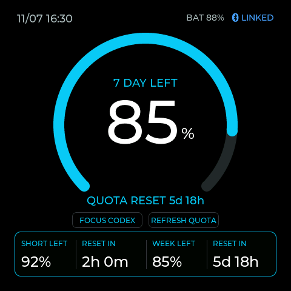

# Codex Display Lite

A restricted Codex quota display for **Waveshare ESP32-S3-Touch-AMOLED-2.16**.
Cyan gauge UI, encrypted Bluetooth, and only two Mac controls: **Focus Codex** and **Refresh Quota**.



## Set up on a MacBook Pro

The device firmware is already installed. Cloning this repository does not require reflashing.

```sh
git clone https://github.com/mxcscd/codex-display-lite.git
cd codex-display-lite
```

1. Use your company-approved Codex installation and company sign-in.
2. Have **CPython 3.13** installed. Runtime wheels are bundled for macOS CPython 3.13.
3. First verify quota without Bluetooth:

   ```sh
   './Start Codex Display.command' --once
   ```

4. Run `Start Codex Display.command` normally, power-cycle the display with BOOT released,
   and pair **Codex Display Lite** using the code on its screen.
5. Keep the Mac awake, nearby and online with the companion running. Control-C stops it.

The launcher creates an isolated environment and installs the bundled dependencies
with exact version and SHA-256 checks, without downloading dependencies.
Private GitHub access is required to clone; use your own permitted GitHub authentication.
Do not copy an access token into this repository.

Full instructions: [MACBOOK_PRO_SETUP.md](MACBOOK_PRO_SETUP.md).

## Controls and data

- Tap **FOCUS CODEX** or **REFRESH QUOTA** on the screen.
- Side user button: short press focuses; one-second hold refreshes.
- BOOT: short press wakes/sleeps; three-second hold clears Bluetooth bonds.
- Middle PWR controls device power.

The gauge shows weekly quota remaining. The bottom panel shows short-window and
weekly quota percentages with reset countdowns. Missing, stale or expired quota is
shown as unavailable. No token-history or running-task collection is enabled.

The companion requests only `account/rateLimits/read` after initialization.
No chat listing, transcript scanning, keyboard automation, AppleScript, arbitrary
shell commands, Wi-Fi application or OTA firmware service is included.
Focus uses `/usr/bin/open -a` with a locally selected app path. Device messages
cannot supply a different app path or command arguments.

See [SECURITY.md](SECURITY.md) for limits and review guidance. This integration is
not independently audited and runs with normal user permissions, not an OS sandbox.

## Verify the source

After setup creates the Python environment:

```sh
restricted_companion/.venv/bin/python -m unittest restricted_companion.test_restrictions -v
shasum -a 256 -c SHA256SUMS.txt
```

Thirteen focused tests cover the request allowlist, numeric-only quota snapshots,
unknown/stale readings, strict command parsing, fixed focus arguments, refresh
rate limits, duplicate commands and encrypted-write-before-command-subscription ordering.
The preview images are renders of the actual LVGL UI using synthetic readings.
The physical board has received the built firmware with verified flash hashes;
Focus/Refresh operation and account pairing on the company Mac remain to be checked.

## Optional firmware build

Only needed when changing the firmware. Install PlatformIO using your approved tools, then:

```sh
PLATFORMIO_CORE_DIR="$PWD/.pio-core" pio run
```

Board configuration and libraries are pinned in `platformio.ini`.
Upload only when explicitly needed; it replaces the installed application.
The original device backup is kept separately on the setup Mac and is not in this repo.

## Attribution

Derived from [jayyao97/codex-usage-display](https://github.com/jayyao97/codex-usage-display),
revision `8bd4ec7adc39ab985bf743da6464152ca70698bb` (MIT).
The original copyright and third-party notices are retained.
Local modifications restrict account access, add fixed Focus/Refresh controls,
pin offline runtime dependencies and restore the gauge layout.
Font licensing is in [LICENSES/OFL-1.1.txt](LICENSES/OFL-1.1.txt).
